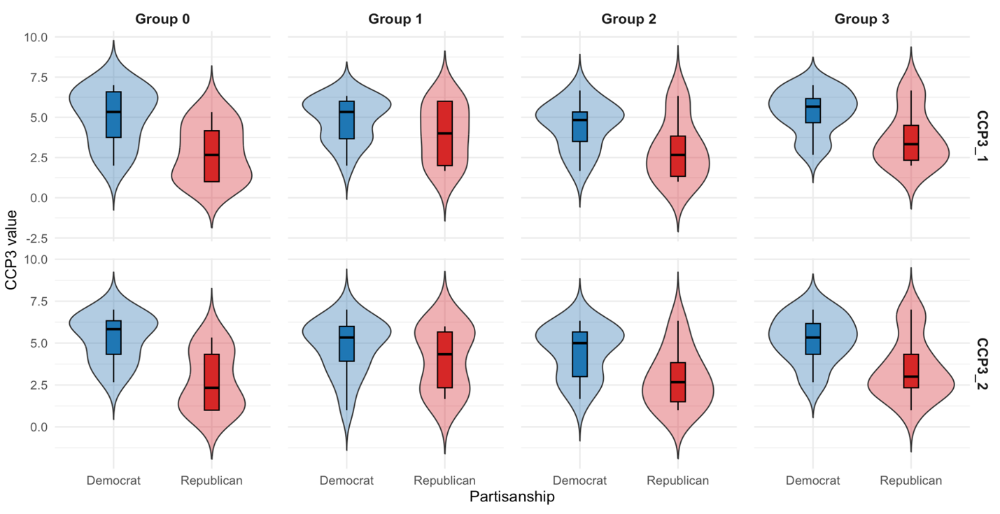
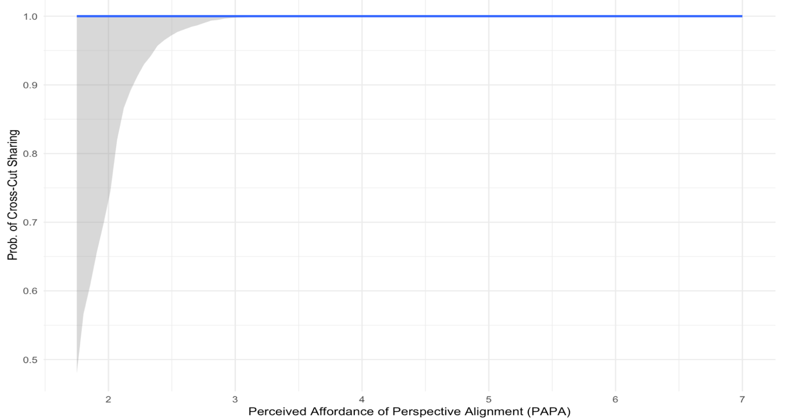
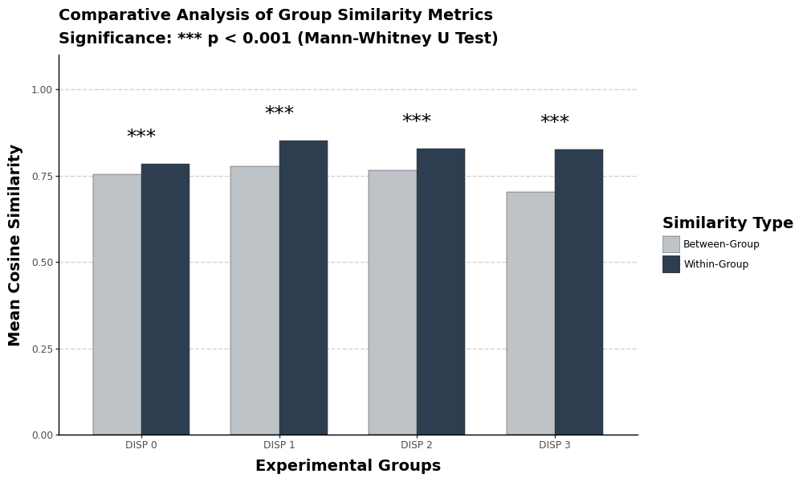
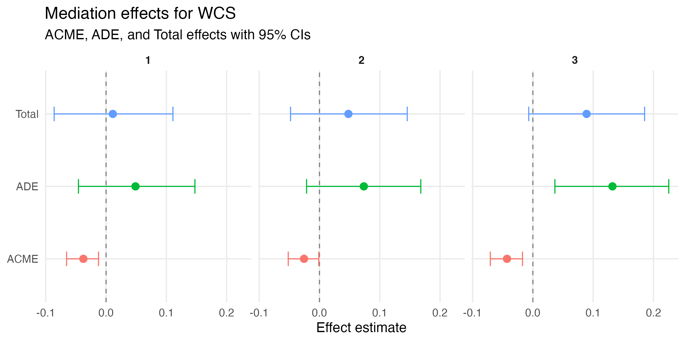
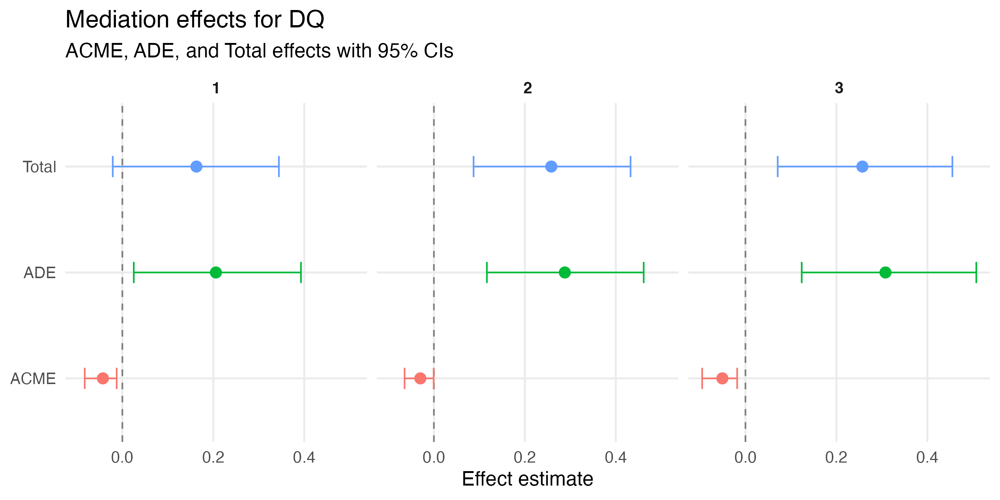
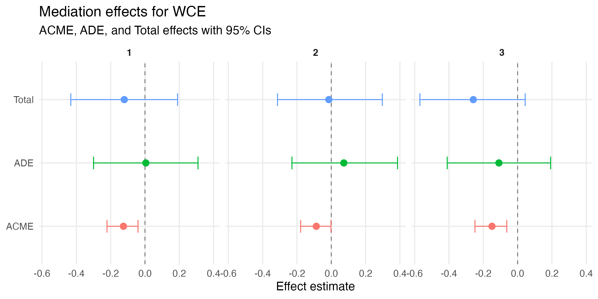
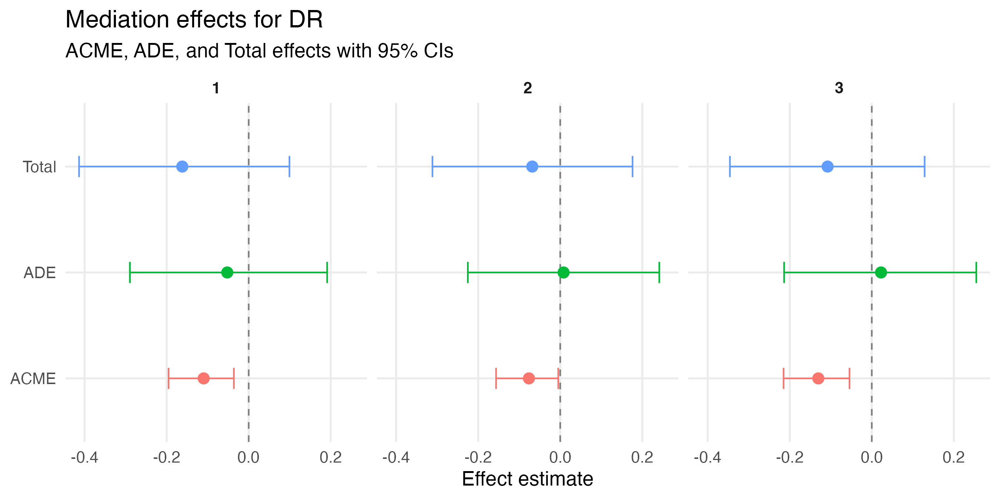

# Content {#contents}

|  | Page |
|:--|--:|
| [1. Pilot Test](#sec-pilot-test) | [2](#sec-pilot-test) |
| [2. Main Experiment](#sec-main-experiment) | [12](#sec-main-experiment) |
| [3. CYON System Prompts](#sec-cyon-system-prompts) | [26](#sec-cyon-system-prompts) |
| [4. CYON Output Examples](#sec-cyon-output-examples) | [35](#sec-cyon-output-examples) |
| [5. Power Analysis & Sampling Scheme](#sec-power-analysis-sampling) | [45](#sec-power-analysis-sampling) |
| [6. Randomization Checks & Manipulation Checks](#sec-randomization-manipulation-checks) | [47](#sec-randomization-manipulation-checks) |
| [7. Debriefing Statement](#sec-debriefing) | [50](#sec-debriefing) |
| [8. Reference](#sec-references) | [51](#sec-references) |

\newpage

# 1. Pilot Test {#sec-pilot-test}

This section reports the analyses of two pilot tests. Both pilots were conducted on the CloudResearch Connect platform under the project title “AI news generator.” The first pilot was administered on October 28, 2025, and the second pilot was administered on November 10, 2025. The data and analysis code are available in the online repository: [<u>https://github.com/casllmproject/bending_effect/</u>](https://github.com/casllmproject/bending_effect/)

## 1.1. First Pilot Descriptive Analysis

**Table S1. First Pilot Data Descriptives (N=123)**

|        | **Age** | **Income** | **Education** | **Conservatism** |
|--------|---------|------------|---------------|------------------|
| **M**  | 46.30   | 6.00       | 5.11          | 3.60             |
| **SD** | 17.49   | 2.19       | 1.39          | 1.99             |

|           | **Gender** |       |        | **Race/Ethnicity** |       |       |       |       |       | **Party Affiliation** |         |         |
|-----------|------------|-------|--------|--------------------|-------|-------|-------|-------|-------|-----------------------|---------|---------|
|           | **F**      | **M** | **NB** | **W**              | **B** | **L** | **A** | **N** | **O** | **Dem**               | **Rep** | **Ind** |
| **Freq.** | 61         | 61    | 1      | 72                 | 32    | 12    | 4     | 2     | 1     | 58                    | 42      | 23      |
| **%**     | 49.6       | 49.6  | .8     | 58.5               | 26.0  | 9.8   | 3.3   | 1.6   | .8    | 47.2                  | 34.1    | 18.7    |

*Note*. Income: 1 = Under \$10,000, 2 = \$10,000 to \$14,999, 3 = \$15,000 to \$24,999, 4 = \$25,000 to \$34,999, 5 = \$35,000 to \$49,999, 6 = \$50,000 to \$74,999, 7 = \$75,000 to \$99,999, 8 = \$100,000 to \$124,999, 9 = \$125,000 to \$149,000, 10 = \$150,000 to \$199,999, 11 = \$200,000 or more; Education: 1 = 8th grade or less, 2 = Some high school, no diploma, 3 = High school graduate or GED, 4 = Some college, no degree, 5 = Associate’s degree, 6 = Bachelor’s degree, 7 = Graduate or professional degree; Conservatism: 1 = Very liberal to 7 = Very conservative; Gender: F = Female, M = Male, NB = Non-Binary; Race/Ethnicity: W = White, B = Black, L = Latinx, A = Asian, N = Native American.

**Table S2. Variable Structures**

|            | ***M*** | ***SD*** | **Cronbach’s α** | **AVE** |
|------------|---------|----------|------------------|---------|
| **DR**     | 4.85    | 1.16     | .77              | .51     |
| **SN**     | .73     | .45      | \-               | \-      |
| **PAPC**   | 5.31    | 1.07     | .97              | .70     |
| **PRA**    | 4.54    | 1.64     | .64              | .61     |
| **CCP3_1** | 4.34    | 2.33     | .93              | .82     |
| **CCP3_2** | 4.32    | 2.33     | .94              | .84     |

*Note*. DR = Democratic Reciprocity; SN = Sharing News Intention (Y =1, N = 0); PAPC = Perceived Affordance of Perspective Coordination; PRA = Perceived Affordance of Perspective Alignment; CCP3 = climate issue involvement (CCP3_1: pre-survey; CCP3_2: post-survey).


## 1.2. Statistical Tests of the First Pilot Data

The first pilot analysis examined differences across four outcome variables among participants randomly assigned to one of four Dialectic Intersubjectivity System Prompting (LEVEL) levels. Ordinal outcomes—Democratic Reciprocity (DR), Perceived Affordance of Perspective Coordination (PAPC), and Perceived Affordance of Perspective Alignment (PRA)—were analyzed using OLS regression, while the dichotomous outcome, Sharing News Intention (SN; 1 = yes, 0 = no), was analyzed using logistic regression. An interaction between partisanship and LEVEL was included to infer a pattern of partisan moderation.

**Table S3. Results of Linear Regression Analyses Predicting PAPC, PRA, and DR**

|                                           | **PAPC**   |      |        | **PRA**    |      |        | **DR**     |      |        |
|-------------------------------------------|------------|------|--------|------------|------|--------|------------|------|--------|
|                                           | *B*        | *SE* | *p*    | *B*        | *SE* | *p*    | *B*        | *SE* | *p*    |
| (Intercept)                               | 5.31\*\*\* | 0.41 | \<.001 | 4.82\*\*\* | 0.42 | \<.001 | 4.82\*\*\* | 0.44 | \<.001 |
| **LEVEL 0 (Ref: Control)**                |            |      |        |            |      |        |            |      |        |
| LEVEL 1                                   | -0.98      | 0.56 | 0.082  | -0.04      | 0.58 | 0.945  | -0.1       | 0.6  | 0.864  |
| LEVEL 2                                   | -0.16      | 0.63 | 0.801  | -0.42      | 0.65 | 0.52   | -0.37      | 0.68 | 0.584  |
| LEVEL 3                                   | 0.5        | 0.74 | 0.505  | 0.43       | 0.77 | 0.578  | 0.93       | 0.8  | 0.247  |
| **Partisanship (Ref: Independent/Other)** |            |      |        |            |      |        |            |      |        |
| Democrat                                  | -0.03      | 0.5  | 0.952  | 0.77       | 0.52 | 0.139  | -0.18      | 0.54 | 0.739  |
| Republican                                | 0.2        | 0.52 | 0.704  | 0.93       | 0.54 | 0.088  | -0.12      | 0.56 | 0.835  |
| **Interactions**                          |            |      |        |            |      |        |            |      |        |
| LEVEL 1 × Democrat                        | 1.21       | 0.68 | 0.08   | -0.91      | 0.71 | 0.201  | 0.4        | 0.73 | 0.589  |
| LEVEL 2 × Democrat                        | 0.27       | 0.76 | 0.724  | -0.25      | 0.79 | 0.75   | 0.85       | 0.82 | 0.297  |
| LEVEL 3 × Democrat                        | -0.59      | 0.84 | 0.485  | -1.22      | 0.87 | 0.163  | -1.38      | 0.9  | 0.128  |
| LEVEL 1 × Republican                      | 1.03       | 0.74 | 0.164  | -0.18      | 0.76 | 0.812  | 0.84       | 0.79 | 0.29   |
| LEVEL 2 × Republican                      | -0.2       | 0.78 | 0.794  | -0.71      | 0.81 | 0.378  | 0.71       | 0.84 | 0.397  |
| LEVEL 3 × Republican                      | -0.46      | 0.87 | 0.601  | -1.06      | 0.9  | 0.241  | -0.43      | 0.94 | 0.648  |
|                                           |            |      |        |            |      |        |            |      |        |
| **Model Statistics**                      |            |      |        |            |      |        |            |      |        |
| *R*<sup>2</sup>                           | 0.08       |      |        | 0.13       |      |        | 0.1        |      |        |
| *F*(11,111)                               | 0.9        |      | 0.548  | 1.51       |      | 0.136  | 1.17       |      | 0.314  |

*Note.* *B* = unstandardized regression coefficient; *SE* = standard error; \**p* \< .05. \*\**p* \< .01. \*\*\**p* \< .001.


**Table S4. Results of Logistic Regression Analysis Predicting SN**

|                                           | *B*    | *SE*    | *OR* | *p*   |
|-------------------------------------------|--------|---------|------|-------|
| (Intercept)                               | -0.29  | 0.76    | 0.75 | 0.706 |
| **LEVEL 0 (Ref: Control)**                |        |         |      |       |
| LEVEL 1                                   | 2.23   | 1.31    | 9.33 | 0.089 |
| LEVEL 2                                   | 1.67   | 1.35    | 5.33 | 0.216 |
| LEVEL 3                                   | 17.85  | 2284.1  | —*a* | 0.994 |
| **Partisanship (Ref: Independent/Other)** |        |         |      |       |
| Democrat                                  | 1.59   | 1       | 4.89 | 0.114 |
| Republican                                | 1.27   | 1.02    | 3.56 | 0.214 |
| **Interactions**                          |        |         |      |       |
| LEVEL 1 × Democrat                        | -3.02  | 1.55    | 0.05 | 0.052 |
| LEVEL 2 × Democrat                        | -1.87  | 1.64    | 0.15 | 0.254 |
| LEVEL 3 × Democrat                        | -18.64 | 2284.1  | —*a* | 0.994 |
| LEVEL 1 × Republican                      | 14.35  | 1318.73 | —*a* | 0.991 |
| LEVEL 2 × Republican                      | -1.67  | 1.66    | 0.19 | 0.313 |
| LEVEL 3 × Republican                      | -17.85 | 2284.1  | —*a* | 0.994 |

*Note*. *OR*= Odds Ratio (Exponentiated *B*). *a* = Odds Ratios for LEVEL 3 and related interactions are extremely large/small and likely unstable due to quasi-complete separation (indicated by massive standard errors). Model fit: 𝜒<sup>2</sup>(11) = 13.41 (calculated as Null Deviance - Residual Deviance), AIC = 153.65.

Moreover, the partisan group level differences on climate opinion by time was tested.

**Table S5. Type III Analysis of Variance Results on CCP3 with Satterthwaite’s Method**

| Source                      | Num *df* | Den *df* | *SS* | *MS* | *F*   | *p*          |
|-----------------------------|----------|----------|------|------|-------|--------------|
| LEVEL                       | 3        | 111      | 0.43 | 0.14 | 1.43  | 0.238        |
| Partisanship                | 2        | 111      | 2.43 | 1.22 | 12.23 | \<.001\*\*\* |
| Time (Pre vs. Post)         | 1        | 111      | 0.02 | 0.02 | 0.2   | 0.655        |
| LEVEL × Partisanship        | 6        | 111      | 0.44 | 0.07 | 0.74  | 0.616        |
| LEVEL × Time                | 3        | 111      | 0.37 | 0.12 | 1.23  | 0.302        |
| Partisanship × Time         | 2        | 111      | 0.11 | 0.06 | 0.57  | 0.566        |
| LEVEL × Partisanship × Time | 6        | 111      | 0.71 | 0.12 | 1.19  | 0.319        |

*Note*. CCP3 = climate issue involvement; Num *df* = Numerator degrees of freedom; Den *df* = Denominator degrees of freedom; *SS* = Sum of Squares; *MS* = Mean Square.

**Table S6. Differences in WD_CCP3 Scores by Assigned Group**

| **Assigned Group** | **Pre-Test** | **Post-Test** | **Change (*Δ*)** |
|--------------------|--------------|---------------|------------------|
| LEVEL 0 (Control)  | 2.35         | 2.56          | \+ .32           |
| LEVEL 1            | .93          | .82           | − .10            |
| LEVEL 2            | 1.56         | 1.63          | \+ .07           |
| LEVEL 3            | 1.63         | 1.77          | \+ .14           |

*Note.* WD_CCP3_1 represents the pre-test measure, and WD_CCP3_2 represents the post-test measure. WD_Change represents the difference of Wasserstein distance score (Post - Pre).

**Figure S1. Wasserstein Distance Score Comparison between CCP3_1 and CCP3_2**

{width=6.5in height=3.34236in}


## 1.3. Second Pilot Descriptive Analysis

**Table S7. Second Pilot Data Descriptives (N=138)**

|        | **Age** | **Income** | **Education** | **Conservatism** |
|--------|---------|------------|---------------|------------------|
| **M**  | 44.75   | 6.72       | 5.24          | 3.96             |
| **SD** | 15.92   | 2.35       | 1.31          | 2.11             |

|           | **Gender** |       |        | **Race/Ethnicity** |       |       |       |       |       | **Party Affiliation** |         |         |
|-----------|------------|-------|--------|--------------------|-------|-------|-------|-------|-------|-----------------------|---------|---------|
|           | **F**      | **M** | **NB** | **W**              | **B** | **L** | **A** | **N** | **O** | **Dem**               | **Rep** | **Ind** |
| **Freq.** | 70         | 68    | \-     | 97                 | 20    | 12    | 8     | \-    | 1     | 70                    | 62      | 6       |
| **%**     | 50.7       | 49.3  | \-     | 70.3               | 14.5  | 8.7   | 5.8   | \-    | .7    | 50.7                  | 44.9    | 4.3     |

*Note*. Income: 1 = Under \$10,000, 2 = \$10,000 to \$14,999, 3 = \$15,000 to \$24,999, 4 = \$25,000 to \$34,999, 5 = \$35,000 to \$49,999, 6 = \$50,000 to \$74,999, 7 = \$75,000 to \$99,999, 8 = \$100,000 to \$124,999, 9 = \$125,000 to \$149,000, 10 = \$150,000 to \$199,999, 11 = \$200,000 or more; Education: 1 = 8th grade or less, 2 = Some high school, no diploma, 3 = High school graduate or GED, 4 = Some college, no degree, 5 = Associate’s degree, 6 = Bachelor’s degree, 7 = Graduate or professional degree; Conservatism: 1 = Very liberal to 7 = Very conservative; Gender: F = Female, M = Male, NB = Non-Binary; Race/Ethnicity: W = White, B = Black, L = Latinx, A = Asian, N = Native American.

**Table S8. Variable Structures**

|         | ***M*** | ***SD*** | **Cronbach’s α** | **AVE** |
|---------|---------|----------|------------------|---------|
| **PRA** | 5.15    | 1.32     | .78              | .63     |
| **WCS** | .67     | .47      | \-               | \-      |
| **DR**  | 1.77    | 1.48     | \-               | \-      |
| **WCE** | 3.36    | 1.82     | .97              | .74     |
| **DR**  | 4.57    | 1.36     | .83              | .57     |

*Note*. PRA = Perceived Affordance of Perspective Alignment ; DR = Democratic Reciprocity; WCS = Willingness to Cross-cut Sharing (Y =1, N = 0); DR = Deliberative Quality of Political Discourse; WCE = Willingness to Climate Civic Participation.


## 1.4. Statistical Tests of the Second Pilot Data

For the second pilot, I first analyzed the extent to which LEVEL predicted PRA, WCS, DR, and DR, using the same analytical approach as in the first pilot. I then conducted a series of mediation analysis to examine the indirect effects of LEVEL on the four outcomes via PRA.

**Table S9. Results of Linear Regression Analyses Predicting PRA**

| **Predictor**         | *B* |       |      | *SE* | *t*   | *p*           |
|-----------------------|-----|-------|------|------|-------|---------------|
| (Intercept)           |     | 3.25  |      | 0.88 | 3.69  | \< .001\*\*\* |
| LEVEL 1               |     | -0.54 |      | 0.33 | -1.66 | 0.102         |
| LEVEL 2               |     | -0.43 |      | 0.33 | -1.3  | 0.199         |
| LEVEL 3               |     | -0.65 |      | 0.31 | -2.08 | .041\*        |
| Republican            |     | -0.35 |      | 0.32 | -1.08 | 0.283         |
| Independent           |     | 0.12  |      | 1.07 | 0.11  | 0.912         |
| Policy Support/Oppose |     | 0.18  |      | 0.08 | 2.1   | .039\*        |
| PEF                   |     | 0.16  |      | 0.13 | 1.23  | 0.222         |
| NFC                   |     | -0.05 |      | 0.09 | -0.56 | 0.574         |
| CII                   |     |       | 0.33 | 0.1  | 3.13  | .002\*\*      |

*Note.* PEF = political efficacy; NFC = need for cognition; CII = climate issue involvement; *B* = unstandardized regression coefficient; *SE* = standard error. *R*<sup>2</sup> = .21, Adj. *R*<sup>2</sup> = .12. *F*(9, 79) = 2.35, *p* = .021; \**p* \< .05. \*\**p* \< .01. \*\*\**p* \< .001.


**Table S10. Multiple Regression Results for Predicting DR, WCE, and DR by PRA**

|                       | **DR**       |       | **WCE**      |              | **DR**       |       |
|-----------------------|--------------|-------|--------------|--------------|--------------|-------|
| **Predictor**         | *B (SE)*     | *p*   | *B (SE)*     | *p*          | *B (SE)*     | *p*   |
| (Intercept)           | 5.02 (2.72)  | 0.069 | 3.91 (1.23)  | .002\*\*     | 2.17 (1.19)  | 0.072 |
| PRA                   | -1.26 (1.07) | 0.243 | -0.21 (0.52) | 0.685        | 0.59 (0.51)  | 0.248 |
| PRA<sup>2</sup>       | 0.11 (0.10)  | 0.296 | 0.02 (0.05)  | 0.648        | -0.03 (0.05) | 0.62  |
| LEVEL                 | 0.73 (0.54)  | 0.184 | -0.12 (0.35) | 0.734        | 0.26 (0.34)  | 0.441 |
| LEVEL<sup>2</sup>     | -0.23 (0.17) | 0.173 | 0.02 (0.11)  | 0.882        | -0.17 (0.11) | 0.123 |
| **Partisanship**      |              |       |              |              |              |       |
| Republican            | 0.00 (0.46)  | 0.993 | -0.00 (0.32) | 0.995        | 0.57 (0.31)  | 0.073 |
| Independent           | 2.24 (1.51)  | 0.143 | -0.84 (0.55) | 0.132        | 0.36 (0.54)  | 0.499 |
| Policy Support/Oppose | 0.09 (0.12)  | 0.473 | 0.07 (0.08)  | 0.369        | 0.05 (0.08)  | 0.491 |
| PEF                   | 0.19 (0.19)  | 0.324 | 0.33 (0.12)  | .007\*\*     | 0.09 (0.12)  | 0.468 |
| NFC                   | -0.13 (0.13) | 0.319 | 0.10 (0.08)  | 0.203        | 0.15 (0.08)  | 0.05  |
| CII                   | 0.20 (0.16)  | 0.202 | 0.77 (0.10)  | \<.001\*\*\* | 0.06 (0.10)  | 0.548 |
| *R*<sup>2</sup>       | .11          |       | .58          |              | .29          |       |
| *F*                   | .99          |       | 16.92\*\*\*  |              | 5.10\*\*\*   |       |

*Note.* PEF = political efficacy; NFC = need for cognition; CII = climate issue involvement; *B* = unstandardized regression coefficient; *SE* = standard error; DR model based on n=89; WCE and DR based on n=135; \**p* \< .05. \*\**p* \< .01. \*\*\**p* \< .001.


**Table S11. Logistic Regression Results Predicting WCS by PRA**

| **Predictor**     | *B*   | *SE* | *z*   | *p*    |
|-------------------|-------|------|-------|--------|
| (Intercept)       | -7.42 | 3.01 | -2.46 | .014\* |
| PRA               | 2.87  | 1.24 | 2.32  | .021\* |
| PRA<sup>2</sup>   | -0.24 | 0.12 | -1.93 | 0.054  |
| LEVEL             | -0.45 | 0.7  | -0.64 | 0.523  |
| LEVEL<sup>2</sup> | 0.24  | 0.23 | 1.05  | 0.296  |
| Partisanship      |       |      |       |        |
| Republican        | 0.25  | 0.67 | 0.38  | 0.704  |
| Independent       | -2.22 | 1.2  | -1.85 | 0.064  |
| CCP1_1_c          | 0.04  | 0.17 | 0.22  | 0.823  |
| PEF               | 0.11  | 0.24 | 0.44  | 0.659  |
| NFC               | 0.08  | 0.15 | 0.51  | 0.612  |
| CII               | 0.26  | 0.21 | 1.24  | 0.217  |

*Note.* WCS = Willingness to Cross-cut Sharing (Y =1, N =0); N = 135. Model fit: 𝜒<sup>2</sup>(10) = 32.45, p \< .001. AIC = 161.41; \**p* \< .05. \*\**p* \< .01. \*\*\**p* \< .001.

**Figure S2. Predicting Probability of WCS by PRA**

{width=6.39062in height=3.41584in}


**Table S12. Summary of Mediation Effects of LEVEL 3 on Outcomes via PRA**

| **Outcome and Effect Type**          | **Estimate** | **95% CI**          |
|--------------------------------------|--------------|---------------------|
| **Cross-Cut Sharing (WCS)**          |              |                     |
| Total Effect                         | 0            | —                   |
| Total Indirect Effect (NIE)          | 0            | \[-0.000, 0.000\]   |
| Linear Component                     | 0.16         | \[-7.057, 7.317\]   |
| Quadratic Component                  | 0.599        | \[-22.627, 29.649\] |
| **Deliberative Quality (DR)**        |              |                     |
| Total Effect                         | 0.601        | —                   |
| Total Indirect Effect (NIE)          | -0.008       | \[-0.350, 0.291\]   |
| Linear Component                     | 0.871        | \[-0.468, 2.950\]   |
| Quadratic Component                  | -0.879       | \[-3.099, 0.605\]   |
| **Willingness to Participate (WCE)** |              |                     |
| Total Effect                         | 0.336        | —                   |
| Total Indirect Effect (NIE)          | 0.011        | \[-0.266, 0.280\]   |
| Linear Component                     | 0.653        | \[-0.519, 2.330\]   |
| Quadratic Component                  | -0.642       | \[-2.461, 0.669\]   |
| **Democratic Reciprocity (DR)**      |              |                     |
| Total Effect                         | 0.106        | —                   |
| Total Indirect Effect (NIE)          | -0.15        | \[-0.488, 0.062\]   |
| Linear Component                     | 0.305        | \[-0.867, 1.779\]   |
| Quadratic Component                  | -0.455       | \[-2.163, 0.786\]   |

*Note.* Results based on 1,000 bootstrap samples. CI = Confidence Interval; NIE = Natural Indirect Effect; LP = Linear Predictor scale. Total effects are reported from the summary analysis; component estimates are reported from the detailed path breakdown. All indirect effects are non-significant as 95% CIs include zero.


# 2. Main Experiment {#sec-main-experiment}

This section provides detailed survey information and supplementary analyses related to the main experiment. Specifically, it includes the survey items and measurement scales for the variables of interest, as well as the codebook used for the gpt-4o-turbo-enhanced automated content analysis of the Deliberative Quality of Political Discourse (DR) variable. In addition, the results of factor analyses for the multi-item measures are reported. These measures include Perspective Recognition Affordance (PRA), Willingness to Climate Civic Participation (WCE), and Democratic Reciprocity (DR). Together, these materials offer detailed documentation of the constructs presented in the main text.

Furthermore, this section reports the full statistical results underlying the analyses summarized in the main text. This includes the results of manipulation checks examining differences in content properties across LEVEL groups; multiple regression analyses assessing the extent to which each LEVEL level predicts PRA; and analyses summarizing the indirect and total effects of each LEVEL level on all outcome variables through PRA. All computational code used for the analyses is available in the online supplementary materials at: [<u>https://github.com/casllmproject/bending_effect/</u>](https://github.com/casllmproject/bending_effect/)

## 2.1. Survey Items

**\[Variables of Interest\]**

1\. Perspective Recognition Affordance (PRA)

Please indicate the extent to which you find each statement applies.

\[Scale: Not at all (1), A little (2), Somewhat (3), Moderately (4), Quite a bit (5), A lot (6), Very much (7), Not sure (99)\]

\(1\) I felt my view was understood by CYON.

\(2\) I saw my viewpoints reflected on the CYON news with respect.

\(3\) CYON was disrespectful to my viewpoint (R).

\(4\) I was able to see my values and beliefs from the CYON news

2\. Democratic Reciprocity (DR)

Please indicate whether you agree or disagree with the following statements.

\[Scale: Strongly disagree (1), Disagree (2), Somewhat disagree (3), Neither agree nor disagree (4), Somewhat agree (5), Agree (6), Strongly agree (7)\]

\(1\) I find it difficult to see things from the point of view of people who disagree with me on climate issues (R)

\(2\) It is important to understand people who disagree with me on climate issues by imagining how things look from their perspective

\(3\) Even if I don’t agree with them, I understand people have good reasons for voting for candidates who disagree with me on climate issues

\(4\) I respect the opinions of people who disagree with me on climate issues

3\. Willingness to Climate Civic Participation (WCE)

Please tell us how willing you are to take part in each of the following activities related to climate issues?

\[Scale: Not at all (1), Very Little (2), A Little (3), Neutral (4), Quite a bit (5), Very much (6), A great deal (7)\]

\(1\) Attend a civic forum or meeting where citizens spoke about climate issues.

\(2\) Contact a newspaper, television station, or radio station regarding climate issues.

\(3\) Sign a petition for climate issues.

\(4\) Contact a public official regarding climate issues.

\(5\) Attend any rallies, protests, boycotts or marches regarding climate issues.

\(6\) Work on behalf of community organizations, a social group, or cause for climate issues.

\(7\) Contribute money to community organizations, a social group or cause for climate issues.

\(8\) Do volunteer work for climate issues.

\(9\) Work on a community project regarding climate issues.

\(10\) Work for a campaign regarding climate issues.

4\. Willingness to Cross-Cut Sharing (WCS)

Please think of someone in your neighborhood or workplace you usually get along with, but who often *disagrees* with you on social or political issues. Let’s call this person **Person A**. Now, imagine you recently talked about climate change with **A**. Would you be willing to share the CYON news you read with **A**?

\[Scale: Yes (1), No (0)\]

5\. Sharing Message

What kind of message would you include when sharing the article with Person A? Please write the message as if you were actually sending it—be as detailed and realistic as possible.

\[Scale: Open-ended text response\]

6\. Deliberative Quality of Political Discourse (DR)

DR is measured through content analysis of the sharing message to determine the presence or absence of the following 8 features:

**\[Codebook for DR\]**

\(1\) Rationality (RAT):

\- Reasoning: Does the sender explicitly try to justify the reason why they are sending this message?

\- Instruction: Code YES when the text explicitly elaborates on why the sender wants the receiver to see this news. The use of words such as "because", "due to", "therefore", “reasons”, “why” can signal an attempt at justification, but texts without these words may still be coded as YES if the comment follows a clear line of reasoning.

\- Example: "it would be really cool for you to read this article to understand why I believe in policies"

\- Coding Scheme: No = 0, Yes = 1, Very YES = 2 (If such expressions appear more than once)

\(2\) Background Information (BGI):

\- Reasoning: Does the sender describe the contextual background for why they are sending the message?

\- Instruction: Code YES when the text describes the broader context or societal issues embedded in the topic.

\- Example: "Trump wants to withdraw from the Paris agreement".

\- Coding Scheme: No = 0, Yes = 1, Very YES = 2 (If such expressions appear more than once)

\(3\) External Evidence (ETV):

\- Reasoning: Does the sender provide external evidence in their message?

\- Instruction: Code YES when the text elaborates on the opinion using facts, media sources, politicians’ statements, or other verifiable evidence. Code YES when the text refers to authorities or experts to support the messege.

\- Example: "Recent studies show green energy is a rapidly growing economic sector", “Trump said...”, “According to the New York Times...”

\- Coding Scheme: No = 0, Yes = 1, Very YES = 2 (If such expressions appear more than once)

\(4\) Reciprocity (REC):

\- Reasoning: Does the sender express curiosity about the receiver’s thoughts or ask a question?

\- Instruction: Code YES when the text uses a question or expressions such as “curious”, “wonder”, “want to know”.

\- Example: "I'm curious to hear what you think about it."

\- Coding Scheme: No = 0, Yes = 1, Very YES = 2 (If such expressions appear more than once)

\(5\) Disrespect (DIS):

\- Reasoning: Does the sender show uncivil attitudes toward the receiver or toward the position of a particular group?

\- Instruction: Code as YES when the text contains expressions implying that the opposing position on the issue is irrational, inferior, ridiculous, or should be excluded from discussion.

\- Example: "This is stupid", “Trump’s withdrawal from the Paris Agreement will definitely hurt our country”, "They should stop..."

\- Coding Scheme: No = 0, Yes = -1, Very YES = -2(If such expressions appear more than once)

\(6\) Acknowledgement (ACK):

\- Reasoning: Does the sender express how they view the receiver’s opinion of them or vice versa?

\- Instruction: Code YES when the text describes differences in opinion between the sender and the receiver.

\- Example: “your belief might be different than mine”, “I believe we have different views on climate change”

\- Coding Scheme: No = 0, Yes = 1, Very YES = 2 (If such expressions appear more than once)

\(7\) Openness (OPN):

\- Reasoning: Does the sender suggest that different perspectives can be viewed fairly?

\- Instruction: Code YES when the text explicitly states that perspectives on the issue can be presented fairly, using expressions such as “fair”, “balanced”, “both sides”.

\- Example: “This is a pretty fair assessment of the situation that shows both sides of the debate”, “we can all get a more balanced perspective”

\- Coding Scheme: No = 0, Yes = 1, Very YES = 2 (If such expressions appear more than once)

\(8\) Solution (SOL):

\- Reasoning: Does the sender propose a joint solution to the receiver?

\- Instruction: Code YES when the text suggests common solutions or alternatives that people with differing positions on the issue may commonly accept.

\- Example: “There are alternative solutions that can lead to a more sustainable future”, “the article can help us find some common grounds”

\- Coding Scheme: No = 0, Yes = 1, Very YES = 2 (If such expressions appear more than once)

**\[Potential Covariates\]**

1\. Partisanship

Generally speaking, do you usually think of yourself as a Democrat, a Republican, an independent, or what?

\[Scale: Democrat (1), Republican (2), Independent (3), Something else (Please specify) (4)\]

2\. Paris Agreement Withdrawal Opinion

Do you support or oppose the U.S. withdrawal from the Paris Agreement? "Support" means agreeing with the current government’s decision, while "Oppose" means disagreeing with it.

\[Scale: Strongly oppose (1), Oppose (2), Somewhat oppose (3), Neutral (4), Somewhat support (5), Support (6), Strongly support (7)\]

3\. Personal Issue Involvement

Please indicate the extent to which each statement applies to your thoughts.

\[Scale: Not at all (1), Very little (2), A little (3), Neutral (4), Quite a bit (5), Very much (6), A great deal (7)\]

\(1\) Does climate change directly affect lots of people like you?

\(2\) Do you feel it is your duty as a citizen to be concerned about climate change?

\(3\) Does climate change directly affect your well-being?

4\. Experience in Disagreement Online

How often do you encounter online content about climate change (including news and social media posts) that you disagree with?

\[Scale: Never (1), Hardly ever (2), Infrequently (3), Sometimes (4), Frequently (5), Often (6), Very often (7)\]

5\. Political Efficacy

How much do you agree with the following statements?

\[Scale: Strongly disagree (1), Disagree (2), Somewhat disagree (3), Neither agree nor disagree (4), Somewhat agree (5), Agree (6), Strongly agree (7)\]

\(1\) I consider myself to be well qualified to participate in politics.

\(2\) I think that I am better informed about politics than most people

\(3\) Other people seem to have an easier time understanding complicated issues than I do (R)

\(4\) Voting gives people an effective way to influence what the government does

\(5\) I can make a difference if I participate in the election process

\(6\) My vote makes a difference

\(7\) I have a real say in what the government does

6\. Conflict Avoidance

How much do you agree with the following statements?

\[Scale: Strongly disagree (1), Disagree (2), Somewhat disagree (3), Neither agree nor disagree (4), Somewhat agree (5), Agree (6), Strongly agree (7)\]

\(1\) I hate arguments about politics

\(2\) I find political conflicts exciting (R)

\(3\) I enjoy challenging the opinions of others (R)

\(4\) Arguments about politics don’t bother me (R)

7\. Need for Cognition

Please give us a little more of a hint about yourself by rating how well each statement fits you.

\[Not at all (1), Mostly not (2), Somewhat not (3), Neutral (4), Somewhat (5), Mostly (6), Extremely (7)\]

\(1\) I would prefer complex to simple problems (R)

\(2\) I like to have the responsibility of handling a situation that requires a lot of thinking (3) Thinking is not my idea of fun (R)

\(4\) I would rather do something that requires little thought than something that is sure to challenge my thinking abilities (R)

\(5\) I really enjoy a task that involves coming up with new solutions to problems

\(6\) I would prefer a task that is intellectual, difficult, and important to one that is somewhat important but does not require much thought

**\[Variables for Exploratory Analysis\]**

1\. AI Cognitive Offloading Propensity (AICOP)

Please read each one and report on the extent to which it describes your thoughts.

\[Scale: Not at All (1), To a Very Small Extent (2), To a Small Extent (3), Neutral (4), To a Great Extent (5), To a Very Great Extent (6), To the Greatest Extent Possible (7), Don't know (99)\]

\(1\) AI assists me tackle a given task effectively

\(2\) AI offers me collaborative results when I'm working alone

\(3\) AI offers helpful examples that I can utilize to solve my problems

\(4\) AI allows me to avoid wasting mental efforts on tedious tasks

\(5\) AI makes a given task seem less complicated

\(6\) AI’s solutions are easily comprehensible

\(7\) AI’s solutions are readily applicable to tasks I’m working on

\(8\) AI guides me to understand essential elements of tasks

\(9\) AI improves my understanding of tasks’ procedures

\(10\) AI provides me assistance by defining unfamiliar terms

\(11\) AI helps me understand complex information

\(12\) AI guides me through the simpler parts of the tasks first

\(13\) AI provides summaries when I’m overwhelmed with information

2\. Perceived Affordances of Perspective Alignment (PAPC)

Please indicate how much you agree or disagree with the statements below.

Through its news content...

\[Scale: Strongly disagree (1), Disagree (2), Somewhat disagree (3), Neither agree nor disagree (4), Somewhat agree (5), Agree (6), Strongly agree (7)\]

\(1\) CYON might present users with diverse perspectives on an issue.

\(2\) CYON might encourage users to view issues from different angles.

\(3\) CYON might help users explore different ideas about an issue.

\(4\) CYON might help users recognize how they view different opinions.

\(5\) CYON might provide insights into how people may respond to opinions different from their own.

\(6\) CYON might help users see how people with different views understand them.

\(7\) CYON might help users suggest reasonable ways to address divisive issues.

\(8\) CYON might help users identify practical solutions to divisive issues.

\(9\) CYON might help users express their opinions in a logical way.

\(10\) CYON might help users listen to people who have different opinions.

\(11\) CYON might help users be more open-minded toward people with opposing views.

\(12\) CYON might help users avoid emotional responses in discussions with people who hold different opinions.


## 2.2. Factor Analysis for Variables of Interests

**Table S13. Exploratory Factor Pattern Coefficients for Principal Axis Extraction (N = 711)**

| **Scale Item**                                                                                                                               | **M** | **SD** | **FL**  | ***h<sup>2</sup>*** |
|----------------------------------------------------------------------------------------------------------------------------------------------|-------|--------|---------|---------------------|
| **PRA**                                                                                                                                      |       |        |         |                     |
| 1\. I felt my view was understood by CYON.                                                                                                   | 4.27  | 1.79   | **.91** | .83                 |
| 2\. I saw my viewpoints reflected on the CYON news with respect.                                                                             | 4.28  | 1.76   | **.87** | .76                 |
| 3\. I was able to see my values and beliefs from the CYON news.                                                                              | 4.13  | 1.79   | **.86** | .74                 |
| 4\. CYON was disrespectful to my viewpoint (R).                                                                                              | 5.51  | 1.98   | -.22    | .05                 |
| **WCE**                                                                                                                                      |       |        |         |                     |
| 1\. Work on behalf of community organizations, a social group, or cause for climate issues.                                                  | 3.57  | 1.95   | **.91** | .83                 |
| 2\. Work on a community project regarding climate issues.                                                                                    | 3.58  | 1.94   | **.90** | .82                 |
| 3\. Do volunteer work for climate issues.                                                                                                    | 3.62  | 1.98   | **.90** | .81                 |
| 4\. Work for a campaign regarding climate issues.                                                                                            | 3.35  | 2.00   | **.89** | .79                 |
| 5\. Contribute money to community organizations, a social group or cause for climate issues.                                                 | 3.49  | 1.98   | **.86** | .75                 |
| 6\. Attend any rallies, protests, boycotts or marches regarding climate issues.                                                              | 3.35  | 2.03   | **.86** | .74                 |
| 7\. Contact a newspaper, television station, or radio station regarding climate issues.                                                      | 3.31  | 1.96   | **.84** | .70                 |
| 8\. Contact a public official regarding climate issues.                                                                                      | 3.74  | 1.99   | **.83** | .69                 |
| 9\. Attend a civic forum or meeting where citizens spoke about climate issues.                                                               | 3.65  | 1.95   | **.83** | .68                 |
| 10\. Sign a petition for climate issues.                                                                                                     | 4.15  | 2.03   | **.74** | .55                 |
| **DR**                                                                                                                                       |       |        |         |                     |
| 1\. Even if I don’t agree with them, I understand people have good reasons for voting for candidates who disagree with me on climate issues. | 4.65  | 1.42   | **.86** | .74                 |
| 2\. I respect the opinions of people who disagree with me on climate issues.                                                                 | 4.7   | 1.43   | **.79** | .63                 |
| 3\. It is important to understand people who disagree with me on climate issues by imagining how things look from their perspective.         | 4.86  | 1.36   | **.65** | .43                 |
| 4\. I find it difficult to see things from the point of view of people who disagree with me on climate issues (R).                           | 4.17  | 1.73   | .07     | .01                 |

*Note*. Principal Axis factoring and Promax rotation were used. Bold numbers indicate that factor loadings are greater than the .40 cutoff. PRA (variance: 65.59%, eigenvalue: 2.62); WCE (variance: 76.0%, eigenvalue: 7.69); DR (variance: 54.57%, eigenvalue: 2.18); *h*<sup>2</sup> = communalities. Communalities are considered high if above .80. However, the more common range in the social sciences ranges from .40 to .70.


## 2.3. Manipulation Check for Content Properties

**Table S14. LEVEL Group Similarity (LEVEL 0–3)**

| **Group**   | **Mean Within Similarity** | **Mean Between Similarity** | **p-value** |
|-------------|----------------------------|-----------------------------|-------------|
| **LEVEL 0** | 0.7836                     | 0.7534                      | \<. 001     |
| **LEVEL 1** | 0.8508                     | 0.7777                      | \<. 001     |
| **LEVEL 2** | 0.8275                     | 0.7661                      | \<. 001     |
| **LEVEL 3** | 0.8258                     | 0.7034                      | \<. 001     |

**Figure S3. Comparative Analysis of Group Similarity Metrics**

{width=6.5in height=3.70198in}

*Note*. **\***\**p* \< .05. \*\**p* \< .01. \*\*\**p* \< .001.


## 2.4. Supplementary Reports for Statistical Analyses

**Table S15. Linear Regression Results for Predicting PRA by LEVEL**

| **Predictor**        | *B*   | *SE* | 95% CI \[LL, UL\] | *t*   | *p*           |
|----------------------|-------|------|-------------------|-------|---------------|
| (Intercept)          | 1.75  | 0.29 | \[1.18,2.32\]     | 6.03  | \< .001\*\*\* |
| Group (Ref: LEVEL 0) |       |      |                   |       |               |
| LEVEL 1              | -0.46 | 0.16 | \[−0.77, −0.16\]  | -2.96 | 0.003\*\*     |
| LEVEL 2              | -0.32 | 0.16 | \[−0.63, −0.02\]  | -2.06 | 0.04\*        |
| LEVEL 3              | -0.55 | 0.16 | \[−0.86, −0.24\]  | -3.53 | \< .001\*\*\* |
| Female               | -0.11 | 0.11 | \[−0.33, 0.11\]   | -0.97 | 0.334         |
| EPE                  | 0.18  | 0.05 | \[0.09, 0.28\]    | 3.83  | \< .001\*\*\* |
| IPE                  | 0.11  | 0.05 | \[0.02, 0.20\]    | 2.44  | 0.015\*       |
| PI                   | 0.3   | 0.05 | \[0.21, 0.39\]    | 6.44  | \< .001\*\*\* |

*Note*. *R*<sup>2</sup> = .215, Adj. *R*<sup>2</sup> = .207. *F*(7, 699) = 27.31, *p* \< .001; \**p* \< .05. \*\**p* \< .01. \*\*\**p* \< .001.

**Table S16. Mediation Analysis of LEVEL 1 Intervention (vs. LEVEL 0) across Outcomes**

| **Outcome** | **Effect Type** | **Estimate** | **95% CI \[LL, UL\]** | **p-value** |
|-------------|-----------------|--------------|-----------------------|-------------|
| **WCE**     | ACME (Mediated) | -0.126       | \[-0.220, -0.043\]    | .002\*\*    |
|             | ADE (Direct)    | 0.005        | \[-0.294, 0.311\]     | 0.935       |
|             | Total Effect    | -0.121       | \[-0.430, 0.195\]     | 0.457       |
| **DR**      | ACME (Mediated) | -0.11        | \[-0.191, -0.037\]    | .002\*\*    |
|             | ADE (Direct)    | -0.052       | \[-0.297, 0.190\]     | 0.678       |
|             | Total Effect    | -0.162       | \[-0.419, 0.090\]     | 0.218       |
| **WCS**     | ACME (Mediated) | -0.038       | \[-0.066, -0.013\]    | .002\*\*    |
|             | ADE (Direct)    | 0.049        | \[-0.044, 0.147\]     | 0.313       |
|             | Total Effect    | 0.011        | \[-0.082, 0.109\]     | 0.835       |
| **DR**      | ACME (Mediated) | -0.043       | \[-0.085, -0.012\]    | .003\*\*    |
|             | ADE (Direct)    | 0.206        | \[0.026, 0.388\]      | .028\*      |
|             | Total Effect    | 0.163        | \[-0.017, 0.345\]     | 0.075       |

*Note*. ACME and ADE estimates represent average effects.; \**p* \< .05, \*\**p* \< .01, \*\*\**p* \< .001.

**Table S17. Mediation Analysis of LEVEL 2 Intervention (vs. LEVEL 0) across Outcomes**

| **Outcome** | **Effect Type** | **Estimate** | **95% CI \[LL, UL\]** | **p-value** |
|-------------|-----------------|--------------|-----------------------|-------------|
| **WCE**     | ACME (Mediated) | -0.087       | \[-0.179, -0.002\]    | .043\*      |
|             | ADE (Direct)    | 0.073        | \[-0.229, 0.377\]     | 0.618       |
|             | Total Effect    | -0.014       | \[-0.315, 0.291\]     | 0.929       |
| **DR**      | ACME (Mediated) | -0.076       | \[-0.158, -0.003\]    | .042\*      |
|             | ADE (Direct)    | 0.008        | \[-0.223, 0.235\]     | 0.936       |
|             | Total Effect    | -0.068       | \[-0.308, 0.168\]     | 0.574       |
| **WCS**     | ACME (Mediated) | -0.026       | \[-0.051, -0.002\]    | .030\*      |
|             | ADE (Direct)    | 0.074        | \[-0.021, 0.167\]     | 0.128       |
|             | Total Effect    | 0.048        | \[-0.050, 0.146\]     | 0.338       |
| **DR**      | ACME (Mediated) | -0.03        | \[-0.065, -0.001\]    | .041\*      |
|             | ADE (Direct)    | 0.288        | \[0.113, 0.465\]      | .001\*\*    |
|             | Total Effect    | 0.258        | \[0.081, 0.434\]      | .004\*\*    |

*Note*. ACME and ADE estimates represent average effects.; \**p* \< .05, \*\**p* \< .01, \*\*\**p* \< .001.

**Table S18. Mediation Analysis of LEVEL 3 Intervention (vs. LEVEL 0) across Outcomes**

| **Outcome** | **Effect Type** | **Estimate** | **95% CI \[LL, UL\]** | **p-value**   |
|-------------|-----------------|--------------|-----------------------|---------------|
| **WCE**     | ACME (Mediated) | -0.149       | \[-0.250, -0.063\]    | \< .001\*\*\* |
|             | ADE (Direct)    | -0.109       | \[-0.419, 0.190\]     | 0.478         |
|             | Total Effect    | -0.258       | \[-0.569, 0.043\]     | 0.096         |
| **DR**      | ACME (Mediated) | -0.13        | \[-0.213, -0.054\]    | \< .001\*\*\* |
|             | ADE (Direct)    | 0.023        | \[-0.197, 0.252\]     | 0.845         |
|             | Total Effect    | -0.108       | \[-0.335, 0.135\]     | 0.377         |
| **WCS**     | ACME (Mediated) | -0.042       | \[-0.071, -0.018\]    | \< .001\*\*\* |
|             | ADE (Direct)    | 0.13         | \[0.041, 0.220\]      | .005\*\*      |
|             | Total Effect    | 0.088        | \[-0.005, 0.180\]     | 0.065         |
| **DR**      | ACME (Mediated) | -0.051       | \[-0.096, -0.018\]    | \< .001\*\*\* |
|             | ADE (Direct)    | 0.308        | \[0.113, 0.499\]      | .003\*\*      |
|             | Total Effect    | 0.257        | \[0.065, 0.445\]      | .009\*\*      |

*Note*. ACME and ADE estimates represent average effects.; \**p* \< .05, \*\**p* \< .01, \*\*\**p* \< .001.


**Figure S4. Mediation Effects of LEVELs via PRA on WCS, DQ, WCE, and DR**

{width=6.3617in height=3.18085in}

{width=6.34043in height=3.17021in}

{width=6.46809in height=3.23404in}

{width=6.53191in height=3.26596in}

*Note*. The numbers 1, 2, and 3 indicate the effects of LEVEL 1, 2, and 3 compared to LEVEL 0.

# 3. CYON System Prompts {#sec-cyon-system-prompts}

This section presents the source code corresponding to the four levels of Dialectic Intersubjectivity System Prompting (LEVEL) embedded in the CYON system. The source code, deployed via Google Cloud Run, is organized into three main stages:

- **Stage 1 (User Profiling and Mapping):**  
  This stage maps participants’ self-reported information collected through Qualtrics to predefined user profiles. The profiling procedure translates survey responses into structured inputs that guide subsequent prompt construction.

- **Stage 2 (System Prompt Engineering):**  
  In this stage, four distinct news-generation system prompts are engineered in accordance with the dialectic intersubjectivity framework. Each prompt corresponds to a different level of intersubjectivity, operationalized as the four LEVEL conditions.

- **Stage 3 (API Call and Response Formatting):**  
  The engineered system prompts are transmitted to a fine-tuned GPT-4o model via an API call. The model’s response (i.e., the generated news content) is then formatted and sent back to the Qualtrics survey interface for participant exposure.

All Python code implementing these three stages is available in the online supplementary materials: [<u>https://github.com/casllmproject/bending_effect/</u>](https://github.com/casllmproject/bending_effect/) In addition, the repository includes:

- JavaScript code that transmits respondent information from the Qualtrics interface to Google Cloud Run; and

- HTML code that renders the news content returned by Google Cloud Run into a web-based format within the Qualtrics survey environment.


## 3.1. Stage 1: Profiling Code

```python
# --- STAGE 1: Data Mapping ---
# Helper function to convert Qualtrics codes into human-readable text
def map_responses(data):
    """Maps Qualtrics' numeric answers to meaningful strings for the AI prompt."""
    mappings = {
        'DEM1': {'1': 'Female', '2': 'Male', '3': 'Non-binary / third gender', '4': 'Prefer not to say'},
        'DEM3': {'1': '8th grade or less', '2': 'Some high school, no diploma', '3': 'High school graduate or GED', '4': 'Some college, no degree', '5': 'Associate’s degree', '6': 'Bachelor’s degree', '7': 'Graduate or professional degree'},
        'DEM4': {'1': 'Under $10,000', '2': '$10,000 to $14,999', '3': '$15,000 to $24,999', '4': '$25,000 to $34,999', '5': '$35,000 to $49,999', '6': '$50,000 to $74,999', '7': '$75,000 to $99,999', '8': '$100,000 to $124,999', '9': '$125,000 to $149,000', '10': '$150,000 to $199,999', '11': '$200,000 or more'},
        'DEM5': {'1': 'Caucasian/White', '2': 'African American/Black', '3': 'Hispanic/Latino', '4': 'Asian', '5': 'American Indian/Alaskan Native', '6': 'Native Hawaiian/Pacific Islander', '7': 'Other'},
        'DEM7': {'1': 'Very liberal', '2': 'Liberal', '3': 'Somewhat liberal', '4': 'Moderate', '5': 'Somewhat conservative', '6': 'Conservative', '7': 'Very conservative'},
        'DEM8': {'1': 'Democrat', '2': 'Republican', '3': 'Independent'},
        'VOT2': {'1': 'The Democratic candidate (Kamala Harris)', '2': 'The Republican candidate (Donald Trump)', '3': 'Another candidate'},
        'CCP1_1': {
            '1': 'Strongly opposes U.S. withdrawal from Paris Agreement',
            '2': 'Opposes U.S. withdrawal from Paris Agreement',
            '3': 'Somewhat opposes U.S. withdrawal from Paris Agreement',
            '4': 'Neutral on U.S. withdrawal from Paris Agreement',
            '5': 'Somewhat supports U.S. withdrawal from Paris Agreement',
            '6': 'Supports U.S. withdrawal from Paris Agreement',
            '7': 'Strongly supports U.S. withdrawal from Paris Agreement'
        }
    }
    profile = {
        "Gender": mappings['DEM1'].get(data.get('DEM1'), "Not specified"),
        "Age": data.get('DEM2', "Not specified"),
        "Education": mappings['DEM3'].get(data.get('DEM3'), "Not specified"),
        "Income": mappings['DEM4'].get(data.get('DEM4'), "Not specified"),
        "Race/Ethnicity": mappings['DEM5'].get(data.get('DEM5'), "Not specified"),
        "Political Stance": mappings['DEM7'].get(data.get('DEM7'), "Not specified"),
        "Party Affiliation": mappings['DEM8'].get(data.get('DEM8'), "Not specified"),
        "2024 Vote": mappings['VOT2'].get(data.get('VOT2'), "Not specified"),
        "Paris Agreement Stance": mappings['CCP1_1'].get(data.get('CCP1_1'), "Neutral on U.S. withdrawal from Paris Agreement")
    }
    return profile
```


## 3.2. Stage 2: System Prompting Code

### 3.2.1. LEVEL 0 (Self Confirming Perspective: Presenting Like-mindedness)

```python
# --- STAGE 2: Prompt Engineering ---
def create_prompt(profile):
    """Creates the detailed prompt for the GPT-4o model."""

    system_prompt = """
    Your task is to generate a short news article about the Trump administration's climate policies.
    Begin with the sentence:
    “The Trump administration announced the U.S. withdrawal from the Paris Agreement in January 2025.This decision comes with far-reaching implications.”

    Strictly follow these rules for the output:
    1. Profile Context:  
    Analyze the user's profile to infer their likely stance on climate change.
    Do NOT mention or refer to the “user," or "profile group" in the article itself.
    2. Article Structure (logically connected to the opening sentence): 
    1) Part 1 (First Paragraph): 
    A news-style paragraph reporting how the user's (ideological or partisan) profile group would assess the policy decision. 
    2) Part 2 (Second Paragraph): 
    A paragraph explaining the reasoning behind why the user's (ideological or partisan) profile group evaluates the policy decision as described in Part 1.    
    3.  Length:
    The article must be between 150 and 180 words in total.
    4.  Headline:
    Include a typical online news-style headline that highlights the user's (ideological or partisan) profile group's perspective or stance on the issue.
    5.  Include exactly 4 external news source labels within the text. Format them like [LABEL:Tooltip text]. For example: [Source: Pew Research Center, Nov 7, 2024]. Do not include actual hyperlinks.
    6.  Your final output must be a valid JSON object with two keys: "headline" and "body".
    """

    user_prompt = f"Here is the survey participant's profile: {json.dumps(profile)}. Generate the news article based on these details and the rules provided."
    
    return system_prompt, user_prompt
```


### 3.2.2. LEVEL 1 (Direct Perspectives: Paralleling Agreement/Disagreement)

```python
# --- STAGE 2: Prompt Engineering ---
def create_prompt(profile):
    """Creates the detailed prompt for the GPT-4o model."""

    system_prompt = """
    Your task is to generate a short news article about the Trump administration's climate policies.
    Begin with the sentence:
    “The Trump administration announced the U.S. withdrawal from the Paris Agreement in January 2025. This decision comes with far-reaching implications.”

    Strictly follow these rules for the output:
    1.  Profile Context:
    Analyze the user's profile to infer their likely stance on climate change.
    2.  Persona Generation:
    Simulate the persona of an American adult who holds the opposite stance on climate change from that inferred from the profile.
    Do NOT mention or refer to the “user," ”profile group," “AI,” or “simulated persona” in the article itself. 
    3.  Article Structure (logically connected to the opening sentence):
    1) Part 1 (THE FIRST PARAGRAPH IN ORDER): 
    A news-style paragraph reporting how the user's (ideological or partisan) profile group would assess the policy decision.
    2) Part 2 (THE SECOND PARAGRAPH IN ORDER — following Part 1): 
    A paragraph that presents the opposing perspective.
    4.  Length:
    The article must be between 150 and 180 words in total.
    5.  Headlline:
    Include a typical online news-style headline that highlights the contrast between the user's (ideological or partisan) profile group's perspective and the simulated persona group's perspective.
    6.  Include exactly 4 external news source labels within the text. Format them like [LABEL:Tooltip text]. For example: [Source: Pew Research Center, Nov 7, 2024]. Do not include actual hyperlinks.
    7.  Your final output must be a valid JSON object with three keys: "headline", "body", and "persona_adopted". The "persona_adopted" key should briefly state the persona you chose (e.g., "Conservative, skeptical of climate regulations").
    """

    user_prompt = f"Here is the survey participant's profile: {json.dumps(profile)}. Generate the news article based on these details and the rules provided."
    
    return system_prompt, user_prompt
```


### 3.2.3. LEVEL 2 (Meta-Perspectives: Juxtaposing Mutual Counterarguments)

```python
# --- STAGE 2: Prompt Engineering ---
def create_prompt(profile):
    """Creates the detailed prompt for the GPT-4o model."""

    system_prompt = """
    Your task is to generate a short news article about the Trump administration's climate policies.
    Begin with the sentence:
    “The Trump administration announced the U.S. withdrawal from the Paris Agreement in January 2025. This decision comes with far-reaching implications.”

    Strictly follow these rules for the output:
    1.  Profile Context:
    Analyze the user's profile to infer their likely stance on climate change.
    2.  Persona Generation:
    Simulate the persona of an American adult who holds the opposite stance on climate change from that inferred from the profile.
    Do NOT mention or refer to the “user,” "profile group," “AI,” or “simulated persona” in the article itself.
    3.  Article Structure (logically connected to the opening sentence):
    1) Part 1 (THE FIRST PARAGRAPH IN ORDER): 
    A news-style paragraph reporting how the user's (ideological or partisan) profile group interprets and evaluates the simulated persona group's opinions or arguments on climate policy, AND why they do so.
    2) Part 2 (THE SECOND PARAGRAPH IN ORDER — following Part 1): 
    A counterargument paragraph describing how the simulated persona's (ideological or partisan) group interprets and evaluates the user profile group's opinions or arguments on climate policy, AND why they do so.
    4.  Tone Requirement: 
    Must use plain, respectful language.
    5.  Length:
    The article must be between 150 and 180 words in total.
    6.  Headline:
    Include a typical online news-style headline that highlights how opposing groups view and interpret each other's perspectives on the issue.
    7.  Include exactly four external news source labels within the text. Format them like [LABEL:Tooltip text]. For example: [Source: Pew Research Center, Nov 7, 2024]. Do not include actual hyperlinks.
    8.  Your final output must be a valid JSON object with three keys: "headline", "body", and "persona_adopted". The "persona_adopted" key should briefly state the persona you chose (e.g., "Conservative, skeptical of climate regulations").
    """

    user_prompt = f"Here is the survey participant's profile: {json.dumps(profile)}. Generate the news article based on these details and the rules provided."
    
    return system_prompt, user_prompt
```


### 3.2.4. LEVEL 3 (Contextual Meta-Perspectives: Realizing Mutual Mis/Understanding)

```python
# --- STAGE 2: Prompt Engineering ---
def create_prompt(profile):
    """Creates the detailed prompt for the GPT-4o model."""

    system_prompt = """
    Your task is to generate a short news article about the Trump administration's climate policies.
    Begin with the sentence:
    “The Trump administration announced the U.S. withdrawal from the Paris Agreement in January 2025. This decision comes with far-reaching implications.”

    Strictly follow these rules for the output:
    1.  Profile Context: 
    Analyze the user's profile to infer their likely stance on climate change.
    2.  Persona Generation:
    Simulate the persona of an American adult who holds the opposite stance on climate change from that inferred from the profile.
    Do NOT mention or refer to the “user,” "profile group," “AI,” or “simulated persona” in the article itself. 
    3.  Article Structure (logically connected to the opening sentence):
    1) Part 1 (THE FIRST PARAGRAPH IN ORDER): 
    A news-style paragraph describing how the user's (ideological or partisan) profile group and the simulated persona group disagree with each other. 
    2) Part 2 (THE SECOND PARAGRAPH IN ORDER — following Part 1):
    A news-style paragraph describing rational and viable solutions proposed by the user's (ideological or partisan) profile group that could be acceptable or agreeable to the simulated persona group.
    3) Part 3 (THE THIRD PARAGRAPH IN ORDER — following Part 2):
    A news-style paragraph explaining why the solutions in Part 2 are acceptable or agreeable to both the user's profile group and the simulated persona group, supported by external statistical evidence or relevant background information.
    4.  Tone Requirement:
    Must use persuasive, suggestive and respectful language.
    5.  Length:
    The article must be between 150 and 180 words in total.
    6.  Headline:
    Include a typical online news-style headline that highlights how different viewpoints could find or build common ground on the issue.
    7.  Include EXACTLY 4 external news source labels within the text. Format them like [LABEL:Tooltip text]. For example: [Source: Pew Research Center, Nov 7, 2024]. Do not include actual hyperlinks.
    8.  Your final output must be a valid JSON object with three keys: "headline", "body", and "persona_adopted". The "persona_adopted" key should briefly state the persona you chose (e.g., "Conservative, skeptical of climate regulations").
    """

    user_prompt = f"Here is the survey participant's profile: {json.dumps(profile)}. Generate the news article based on these details and the rules provided."
    
    return system_prompt, user_prompt
```

## 3.3. Stage 3: API Call and Response Formatting Code

```python
# --- STAGE 3: API Call and Response Formatting ---
def format_body_with_hovers(text_body):
    """Converts [LABEL:Tooltip] syntax into HTML for Qualtrics."""
    def replacer(match):
        label = match.group(1)
        tooltip = match.group(2)
        # Using a standard span structure for easy integration into an HTML/Qualtrics context
        return f'<span class="source-label">{label}<span class="source-tooltip">{tooltip}</span></span>'
    
    # --- FIXED: Use the globally compiled regex pattern ---
    return HOVER_PATTERN.sub(replacer, text_body)

# The function entry point, required for Google Cloud Functions
@functions_framework.http
def generate_news_endpoint(request):
    """The main entry point for the Cloud Function.
    
    This function handles the cross-origin preflight request (OPTIONS) and the
    main POST request to generate the news article using the OpenAI API.
    """
    
    # 1. Handle CORS Preflight Request (for Qualtrics/Web Access)
    if request.method == 'OPTIONS':
        headers = {
            'Access-Control-Allow-Origin': '*',
            'Access-Control-Allow-Methods': 'POST',
            'Access-Control-Allow-Headers': 'Content-Type',
            'Access-Control-Max-Age': '3600'
        }
        return ('', 204, headers)

    # Set standard CORS headers for the response
    headers = {'Access-Control-Allow-Origin': '*'}
    
    try:
        # --- FIXED: Check if global client failed to initialize ---
        if CLIENT is None:
            raise EnvironmentError("OPENAI_API_KEY is not set or client failed to initialize.")
        
        request_data = request.get_json(silent=True)
        if not request_data:
            return (jsonify({"error": "Missing JSON payload in request."}), 400, headers)
            
        participant_profile = map_responses(request_data)
        system_prompt, user_prompt = create_prompt(participant_profile)
        
        # 2. Call OpenAI API
        completion = CLIENT.chat.completions.create(
            model="ft:gpt-4o-2024-08-06:personal::A8vV3mNd",
            messages=[
                {"role": "system", "content": system_prompt},
                {"role": "user", "content": user_prompt}
            ],
            temperature=0.7,
            response_format={"type": "json_object"},
            # --- NEW: Add a server-side timeout ---
            # This is crucial. It ensures your function fails gracefully
            # if the OpenAI API hangs, *before* your JavaScript times out.
            # Set this to be *less* than your JavaScript timeout (e.g., 40s).
            timeout=40.0 
        )
        
        # 3. Process Response
        response_json_string = completion.choices[0].message.content
        response_data = json.loads(response_json_string)
        
        headline = response_data.get("headline", "No Headline")
        body_raw = response_data.get("body", "No content generated.")
        body_formatted = format_body_with_hovers(body_raw)
        
        final_response = {
            "headline": headline,
            "body": body_formatted,
            "debug_info": {
                "profile": participant_profile
            }
        }
        
        # 4. Return Formatted JSON Response
        return (jsonify(final_response), 200, headers)

    # --- NEW: Add specific OpenAI error handling ---
    except RateLimitError as e:
        error_message = {"error": "OpenAI API rate limit exceeded.", "message": str(e)}
        print(f"RateLimitError: {e}")
        return (jsonify(error_message), 429, headers) # 429 Too Many Requests

    except APIConnectionError as e:
        error_message = {"error": "Could not connect to OpenAI API.", "message": str(e)}
        print(f"APIConnectionError: {e}")
        return (jsonify(error_message), 503, headers) # 503 Service Unavailable

    except APIError as e:
        error_message = {"error": "OpenAI API returned an error.", "message": str(e)}
        print(f"APIError: {e}")
        return (jsonify(error_message), 502, headers) # 502 Bad Gateway
    # --- END NEW ---

    except EnvironmentError as ee:
        # Catch specific configuration errors
        error_message = {"error": str(ee), "message": "Server configuration error."}
        print(f"Configuration Error: {ee}")
        return (jsonify(error_message), 500, headers)

    except Exception as e:
        # Catch all other errors
        error_message = {"error": str(e), "message": "An internal server error occurred."}
        print(f"Error processing request: {e}") 
        return (jsonify(error_message), 500, headers)
```


# 4. CYON Output Examples {#sec-cyon-output-examples}

This section presents a selection of cases from the CYON news content generated in the main experiment and randomly exposed to participants. Specifically, for each LEVEL level, one news article provided to a participant identified as belonging to the group supporting the U.S. withdrawal from the Paris Agreement and one news article provided to a participant identified as belonging to the group opposing the withdrawal were selected.

Moreover, there were cases in which partisan affiliation and policy support were incongruent. Specifically, 55 respondents identified as Democrats while supporting withdrawal, and 54 respondents identified as Republicans while opposing withdrawal. Among these incongruent cases, one case from each side was included from the LEVEL 1 group, which allows for the illustration of within-party divergence in positions.

In total, ten news articles (4 LEVEL levels × 2 group profiles and 2 incongruent cases from LEVEL 1 condition) are included here. External source links embedded as interactive features were removed from the excerpted articles:


## 4.1. LEVEL 0 (Self Confirming Perspective: Presenting Like-mindedness)

### 4.1.1. Group Supporting the U.S. Withdrawal from the Paris Agreement

<table>
<colgroup>
<col style="width: 100%" />
</colgroup>
<thead>
<tr class="header">
<th><p><em><strong>Conservatives Applaud U.S. Exit from Paris Agreement as Strategic Move</strong></em></p>
<p>The Trump administration announced the U.S. withdrawal from the Paris Agreement in January 2025. This decision comes with far-reaching implications. Among conservative Republicans, this move is celebrated as a decisive step towards reclaiming national sovereignty and prioritizing economic growth over international obligations. Supporters argue that the agreement imposed unfair restrictions on American industries, burdening the economy with regulations that disadvantaged the U.S. in the global market.</p>
<p>The reasoning behind this perspective is rooted in a belief that the Paris Agreement was detrimental to American economic interests, with critics citing the potential for job losses and increased energy costs as key concerns. Additionally, the withdrawal aligns with a broader ideological stance that emphasizes national autonomy and skepticism towards global governance frameworks. For conservative Republicans, this policy is seen as a reaffirmation of prioritizing national interests in foreign policy decisions.</p></th>
</tr>
</thead>
<tbody>
</tbody>
</table>

### 4.1.2. Group Opposing the U.S. Withdrawal from the Paris Agreement

<table>
<colgroup>
<col style="width: 100%" />
</colgroup>
<thead>
<tr class="header">
<th><p><em><strong>Liberal Concerns Mount Over U.S. Exit from Paris Agreement</strong></em></p>
<p>The Trump administration announced the U.S. withdrawal from the Paris Agreement in January 2025. This decision comes with far-reaching implications. Among somewhat liberal and Democratic-leaning individuals, the move is seen as a detrimental step backward in the fight against climate change. The withdrawal aligns with a broader pattern of skepticism towards international environmental efforts, troubling those who prioritize sustainability and global cooperation.</p>
<p>The evaluation stems from a strong belief in the necessity of collaborative efforts to mitigate the impacts of climate change. Supporters of the Paris Agreement argue that such international accords are crucial for setting binding commitments and fostering innovation in green technologies. The withdrawal is perceived as undermining U.S. leadership on the global stage and potentially hindering progress towards reducing carbon emissions. Critics emphasize the importance of maintaining commitments to avoid exacerbating climate-related challenges.</p></th>
</tr>
</thead>
<tbody>
</tbody>
</table>


## 4.2. LEVEL 1 (Direct Perspectives: Paralleling Agreement/Disagreement)

### 4.2.1. Group Supporting the U.S. Withdrawal from the Paris Agreement

<table>
<colgroup>
<col style="width: 100%" />
</colgroup>
<thead>
<tr class="header">
<th><p><em><strong>Conservatives Applaud Withdrawal, While Environmentalists Express Alarm</strong></em></p>
<p>The Trump administration announced the U.S. withdrawal from the Paris Agreement in January 2025. This decision comes with far-reaching implications. Supporters, particularly from conservative circles, view the move as a necessary step towards prioritizing national interests and economic growth. Many see the agreement as a hindrance to the U.S. energy sector and believe that withdrawal will lead to greater energy independence and job creation.</p>
<p>In stark contrast, environmental advocates express deep concern over the withdrawal's impact on global climate efforts. They argue that the decision undermines international collaboration and jeopardizes progress in combating climate change. Critics worry that this shift will weaken the global response to environmental challenges and exacerbate the effects of climate change, urging a recommitment to global agreements. Both sides remain deeply entrenched in their views, highlighting the ongoing division over climate policies in the U.S.</p></th>
</tr>
</thead>
<tbody>
</tbody>
</table>

### 4.2.2. Group Opposing the U.S. Withdrawal from the Paris Agreement

<table>
<colgroup>
<col style="width: 100%" />
</colgroup>
<thead>
<tr class="header">
<th><p><em><strong>Liberal Concerns Clash with Conservative Approval over Paris Agreement Exit</strong></em></p>
<p>The Trump administration announced the U.S. withdrawal from the Paris Agreement in January 2025. This decision comes with far-reaching implications. Many within the progressive and environmentally conscious circles, who emphasize the urgency of addressing climate change, view the exit as a detrimental setback to global environmental efforts. They argue that the withdrawal undermines international commitments to reduce carbon emissions and transition to sustainable energy sources. The move is perceived as a step backward in the fight against climate change, especially as the world faces increasing climate-related challenges.</p>
<p>Conversely, those who are skeptical of stringent climate regulations see the decision as a victory for economic pragmatism and national sovereignty. They argue that the Paris Agreement imposes unfair economic burdens on the United States and hinders domestic industries. This perspective supports prioritizing economic growth and energy independence over international climate commitments.</p></th>
</tr>
</thead>
<tbody>
</tbody>
</table>


## 4.3. LEVEL 2 (Meta-Perspectives: Juxtaposing Mutual Counterarguments)

### 4.3.1. Group Supporting the U.S. Withdrawal from the Paris Agreement

<table>
<colgroup>
<col style="width: 100%" />
</colgroup>
<thead>
<tr class="header">
<th><p><em><strong>Climate Policy Clash: Differing Views on the Paris Agreement Withdrawal</strong></em></p>
<p>The Trump administration announced the U.S. withdrawal from the Paris Agreement in January 2025. This decision comes with far-reaching implications. Conservatives often view the opposing group's emphasis on climate action as overly alarmist and neglectful of economic and national interests. They argue that prioritizing American energy independence and reducing regulatory burdens is essential for economic growth and sovereignty.</p>
<p>Conversely, the opposing group, often more progressive and environmentally focused, interprets the conservatives’ stance as short-sighted and detrimental to global cooperation on climate change. They emphasize the long-term benefits of renewable energy investments and international collaboration, arguing that such strategies are crucial for addressing climate risks and ensuring environmental sustainability. This clash underscores the persistent divide in how different segments of the American populace perceive and prioritize climate policies.</p></th>
</tr>
</thead>
<tbody>
</tbody>
</table>

### 4.3.2. Group Opposing the U.S. Withdrawal from the Paris Agreement

<table>
<colgroup>
<col style="width: 100%" />
</colgroup>
<thead>
<tr class="header">
<th><p><em><strong>Diverging Views on Climate Policy: A Look at the Impasse</strong></em></p>
<p>The Trump administration announced the U.S. withdrawal from the Paris Agreement in January 2025. This decision comes with far-reaching implications. Among those who strongly oppose the withdrawal, the decision is seen as a step backward in addressing global climate change. They argue that international cooperation is crucial to tackling environmental challenges and that the withdrawal isolates the U.S. on the world stage. This group views the opposing stance as short-sighted and driven by economic interests at the expense of environmental sustainability.</p>
<p>On the other hand, those who support the withdrawal interpret the opposition's views as overly idealistic, believing that the Paris Agreement imposes unfair economic burdens on the U.S. They argue that national policies should prioritize economic growth and energy independence over international commitments. They see the opposition's stance as neglecting the practical implications for American industries and jobs.</p></th>
</tr>
</thead>
<tbody>
</tbody>
</table>

## 4.4. LEVEL 3 (Contextual Meta-Perspectives: Realizing Mutual Mis/Understanding)

### 4.4.1. Group Supporting the U.S. Withdrawal from the Paris Agreement

<table>
<colgroup>
<col style="width: 100%" />
</colgroup>
<thead>
<tr class="header">
<th><p><em><strong>Finding Common Ground: Navigating the U.S. Exit from the Paris Agreement</strong></em></p>
<p>The Trump administration announced the U.S. withdrawal from the Paris Agreement in January 2025. This decision comes with far-reaching implications. The move has highlighted a stark division between those who support the withdrawal, typically conservative individuals who prioritize national sovereignty and economic growth, and those who oppose it, often advocating for immediate and robust climate action. These groups are fundamentally at odds, as the former seeks to lessen regulatory burdens while the latter emphasizes the urgency of environmental stewardship.</p>
<p>Despite these differences, rational solutions proposed by supporters of the withdrawal focus on market-driven innovations and technological advancements in clean energy. These solutions emphasize economic benefits and energy independence, which could potentially align with the interests of those more skeptical about strict climate regulations. These solutions are agreeable to both groups because they offer a pathway to reducing emissions without imposing stringent regulations. Market-based approaches, such as incentivizing renewable energy investments, have shown to be effective in reducing carbon footprints while fostering economic growth, appealing to both environmental and economic priorities. The integration of technology and innovation provides a common ground, supporting economic resilience as well as environmental responsibility.</p></th>
</tr>
</thead>
<tbody>
</tbody>
</table>

### 4.4.2. Group Opposing the U.S. Withdrawal from the Paris Agreement

<table>
<colgroup>
<col style="width: 100%" />
</colgroup>
<thead>
<tr class="header">
<th><p><em><strong>Bridging the Divide: Finding Common Ground on Climate Policy</strong></em></p>
<p>The Trump administration announced the U.S. withdrawal from the Paris Agreement in January 2025. This decision comes with far-reaching implications. Liberals, who generally prioritize environmental protection and support international climate agreements, are at odds with conservatives who often emphasize economic growth and national sovereignty over global commitments. This ideological divide highlights contrasting values, with each group perceiving the impact of climate policies through different lenses.</p>
<p>In response to the withdrawal, liberals propose enhancing renewable energy investments and implementing market-based carbon reduction strategies, such as carbon pricing, to mitigate environmental impact while promoting economic stability. These solutions aim to balance ecological concerns with economic interests, seeking to appeal to a broader audience by demonstrating potential economic benefits. The proposed solutions are agreeable to both sides due to their dual focus on environmental sustainability and economic viability. The growing efficiency of renewable technologies and the economic incentives from carbon pricing have shown promise in reducing emissions without stifling growth. This pragmatic approach resonates with both groups, offering a pathway to address climate change that respects diverse priorities.</p></th>
</tr>
</thead>
<tbody>
</tbody>
</table>


## 4.5. LEVEL 1 Cases for Incongruent Policy Stance

### 4.5.1. Liberal Supporting Withdrawal

<table>
<colgroup>
<col style="width: 100%" />
</colgroup>
<thead>
<tr class="header">
<th><p><em><strong>Liberal Surprise: Praise for Paris Withdrawal Sparks Debate with Environmental Advocates</strong></em></p>
<p>The Trump administration announced the U.S. withdrawal from the Paris Agreement in January 2025. This decision comes with far-reaching implications. Among liberals, the move is seen as a betrayal of global environmental commitments and a step back in the fight against climate change. Supporters argue that staying in the agreement was vital for international cooperation and necessary to combat the climate crisis.</p>
<p>In contrast, some individuals who typically align with liberal values but support the withdrawal view it as a pragmatic decision that prioritizes economic growth and national interests over international obligations. They argue that the agreement imposes unfair burdens on the U.S. economy and that resources should be directed towards domestic innovation and energy independence.</p></th>
</tr>
</thead>
<tbody>
</tbody>
</table>

### 4.5.2. Conservative Opposing Withdrawal

<table>
<colgroup>
<col style="width: 100%" />
</colgroup>
<thead>
<tr class="header">
<th><p><em><strong>Conservatives Debate as U.S. Exits Paris Accord: A Clash of Climate Views</strong></em></p>
<p>The Trump administration announced the U.S. withdrawal from the Paris Agreement in January 2025. This decision comes with far-reaching implications. Among those who lean conservative and align with Republican values, there is a nuanced reaction. While traditionally supportive of Trump's policies, some express concern over the environmental impact and diplomatic repercussions of leaving the accord. This group highlights the importance of global cooperation in tackling climate change, despite their conservative stance.</p>
<p>In contrast, others who are skeptical of stringent climate regulations view the withdrawal as a necessary step to prioritize American economic interests and reduce regulatory burdens. They argue that the Paris Agreement imposes unfair limitations on U.S. industries, and exiting is seen as a move to restore national sovereignty. This perspective underscores a broader skepticism towards international climate commitments.</p></th>
</tr>
</thead>
<tbody>
</tbody>
</table>

# 5. Power Analysis & Sampling Scheme {#sec-power-analysis-sampling}

## 5.1. A Priori Power Analysis

The effects of cross-cutting media exposure on political outcomes are highly variable. A meta-analysis of its impact on political participation reported non-significant results, whereas experimental studies found stronger effects (Matthes et al., 2019). Given this study’s normative concerns, one relevant point of comparison is a longitudinal analysis by Lin et al. (2025), which examined how varying frequencies of cross-cutting exposure differentially shape changes in political attitudes toward out-groups and estimated an effect size of Cohen’s *f* = .195 (*r* ≈ .192).

Guided by the smallest effect size of interest (SESOI) approach (Riesthuis, 2024), I conducted a series of *a priori* power analyses for a one-way design with four groups. Using G\*Power (Faul et al., 2007), I specified effect sizes in the small-to-medium range (*f* = .15-.20; Cohen, 1988), an *α* level of .05, and equal group sizes. Results indicated that detecting an effect of *f* = .15 with 80% power required a total sample of N = 492 (123 per group), whereas 90% power required N = 636 (159 per group). Based on these estimates, the study targeted a total sample of approximately *N = 700* (175 per group). This size provides sufficient sensitivity to detect effects in the small-to-medium range while maintaining parsimony.

## 5.2. Sampling Scheme

Within the range estimated by the power analysis (*N ≈ 700*), data collection was administered by Dynata, a professional research panel platform. Dynata provided samples with non-nested quotas using US Census percentages by age, gender, race, and region. Before full-scale implementation, a soft launch with 100 respondents to assess both data quality and the CYON outputs was executed.

In the main study, a total of 711 participants who passed the attention checks were retained for analysis. After providing informed consent to participate in a *beta test* of the AI-powered news service CYON, respondents proceeded to the pre-test survey.

# 6. Randomization Checks & Manipulation Checks {#sec-randomization-manipulation-checks}

**Randomization Checks**

Participants were randomly assigned to DISP 0 (N=178), DISP 1 (N=175), DISP 2 (N=179), and DISP 3 (N=179). Two series of chi-square tests were performed to examine whether randomization was successful regardless of gender and partisan affiliation. While DISP group assignment was not biased by partisanship (*χ*²(9, 711) = 13.33, *p* = .148), there was a significant difference in assignment between female and male participants (*χ*²(3, 711) = 8.34, *p* = .040). Specifically, 21.4% of females were assigned to DISP 0 compared to 29.5% of males, whereas 27.6% of females were assigned to DISP 3 compared to 22.3% of males.

Additionally, one-way ANOVA tests revealed differences across assignment groups for external political efficacy (*F*(3, 707) = 7.34, *p* \< .001) and internal political efficacy (*F*(3, 710) = 3.53, *p* = .015). Although the variation in political interest across assignment groups was not statistically significant (*F*(3, 710) = 2.30, *p* = .077), pairwise comparison analysis indicated a significant difference in political interest levels between the DISP 1 and DISP 2 groups (*p* = .045, 95% CI \[.0066, .8512\]).

Other variables that prior research has suggested influence the level of political participation and the nature of deliberation—i.e., media trust, conflict avoidance regarding political issues, issue involvement, and exposure to media expressing perspectives with which one disagrees—did not differ by group. Accordingly, all subsequent analyses controlled for dummy-coded female gender, external political efficacy, internal political efficacy, and political interest (detailed measures for these variables are provided in SM 2.1.).

## 6.2. Manipulation Checks

As described in Chapters 2 to 5, the differential intersubjectivity effects in this study are grounded in the framing effects literature. This tradition conceptualizes media frames in two ways: first, as “attributes of the news itself” (Entman, 1993, p. 7), and second, as “mentally stored clusters of ideas that guide individuals’ processing of information” (p. 53). In other words, frames can be understood both as the properties of news media and as the cognitive constructs or mental schemas individuals use to interpret information (Scheufele & Tewksbury, 2007).

In this respect, the present algorithmic embedding of dialectic intersubjectivity cues seeks to manipulate both aspects. At the system level, source code instructing the LLM to generate news at a given intersubjectivity level (DISP) is designed to direct interpretation. That is, the system prompt is crafted to *attempt inducing four distinct intersubjective readings* (i.e., mental schemas) of the same issue. At the content level, CYON is designed so that the news assigned to each of the four experimental groups reflects *different textual properties or media attributes*.

Accordingly, I performed manipulation checks across both the “message properties” and “psychological states” dimensions (O’Keefe, 2003). First, I evaluated whether CYON-generated news assigned to different groups exhibits distinct textual characteristics. To do so, I analyzed the text similarity of news articles both within and between groups. Using the pre-trained Sentence Transformer model SBERT (Reimers et al., 2019), the analysis showed that within-group text similarity was significantly higher than between-group text similarity (Table S13; Figure S3). This suggests that the *message properties* of news assigned to each group hold thematic and syntactic characteristics distinct from those of other groups.

Second, I tested whether these distinct texts manipulated *psychological states* via initiation of differential cognitive processing. This was assessed through an explicit manipulation check survey item following news exposure. Participants were asked to respond to the following question: “Please select the statement that BEST describes the CYON news you just read...(1) It mostly expressed opinions that align with my own views; (2) It technically showed viewpoints similar to mine and opposing ones side by side; (3) It technically described how opposing groups evaluate each other’s perspectives; (4) It highlighted how different viewpoints can find common ground.” While the order of answer options was randomized, it corresponded to the DISP levels.

The chi-square analyses indicate that respondents’ perceptions of how the CYON news was framed varied systematically across the randomly assigned DISP conditions, supporting the effectiveness of the experimental manipulation. The association between DISP and perceived framing was reliable, *χ*²(9, 711) = 72.01, *p* \< .001, with no violations of expected cell count assumptions, and the significant linear-by-linear association, *χ*²(1, 711) = 32.83, *p* \< .001, suggests an ordered pattern across DISP levels rather than random fluctuation. Consistent with this, symmetric measures indicated a moderate association between DISP and perceived framing (Cramér’s *V* = .18, Φ = .32, *p* \< .001), indicating that the manipulation successfully shaped participants’ interpretations of the treatment in an intended way.

# 7. Debriefing {#sec-debriefing}

Upon completing the post-survey (i.e., items for manipulation check; mediator; and outcomes), participants were informed that the study was not an actual beta test, but an online experiment designed to investigate how generative AI affects civic perceptions and behaviors. They were told that their contributions provide valuable data for preventing potential negative social and political consequences of AI use. Participants were assured that they may request to have their responses removed at any time, and that all data are stored on encrypted computers accessible only to researchers authorized by the host institution.

# 8. References {#sec-references}

Cohen, J. (1988). *Statistical power analysis for the behavioral sciences (2nd edition)*. Lawrence Erlbaum.

Entman, R. M. (1993). Framing: Towards clarification of a fractured paradigm. *McQuail’s Reader in Mass Communication Theory, 390*, 397.

Faul, F., Erdfelder, E., Lang, A. G., & Buchner, A. (2007). G\* Power 3: A flexible statistical power analysis program for the social, behavioral, and biomedical sciences. *Behavior Research Methods, 39*(2), 175-191. [<u>https://doi.org/10.3758/BF03193146</u>](https://doi.org/10.3758/BF03193146)

Lin, H., Jiang, X., Lee, J., Wang, Y., & Kim, Y. (2025). Exploring the paradox of cross-cutting exposure and affective polarization: A curvilinear model influenced by political ideology Strength. *Media Psychology, 1-25*. [<u>https://doi.org/10.1080/15213269.2024.2445031</u>](https://doi.org/10.1080/15213269.2024.2445031)

Matthes, J., Knoll, J., Valenzuela, S., Hopmann, D. N., & Von Sikorski, C. (2019). A meta-analysis of the effects of cross-cutting exposure on political participation. *Political Communication, 36*(4), 523-542. [<u>https://doi.org/10.1080/10584609.2019.1619638</u>](https://doi.org/10.1080/10584609.2019.1619638)  

O’Keefe, D. J. (2003). Message properties, mediating states, and manipulation checks: Claims, evidence, and data analysis in experimental persuasive message effects research. *Communication Theory, 13*(3), 251-274. [<u>https://doi.org/10.1111/j.1468-2885.2003.tb00292.x</u>](https://doi.org/10.1111/j.1468-2885.2003.tb00292.x)

Reimers, N., & Gurevych, I. (2019, November). Sentence-bert: Sentence embeddings using siamese bert-networks. In *Proceedings of the 2019 conference on empirical methods in natural language processing and the 9th international joint conference on natural language processing (EMNLP-IJCNLP)* (pp. 3982-3992). [<u>https://doi.org/10.18653/v1/D19-1410</u>](https://doi.org/10.18653/v1/D19-1410)

Riesthuis, P. (2024). Simulation-based power analyses for the smallest effect size of interest: A confidence-interval approach for minimum-effect and equivalence testing. *Advances in Methods and Practices in Psychological Science, 7*(2), 25152459241240722. [<u>https://doi.org/10.1177/25152459241240722</u>](https://doi.org/10.1177/25152459241240722)

Scheufele, D. A., & Tewksbury, D. (2007). Framing, agenda setting, and priming: The evolution of three media effects models. *Journal of Communication, 57*(1), 9-20. [<u>https://doi.org/10.1080/15205436.2015.1068811</u>](https://doi.org/10.1080/15205436.2015.1068811)
